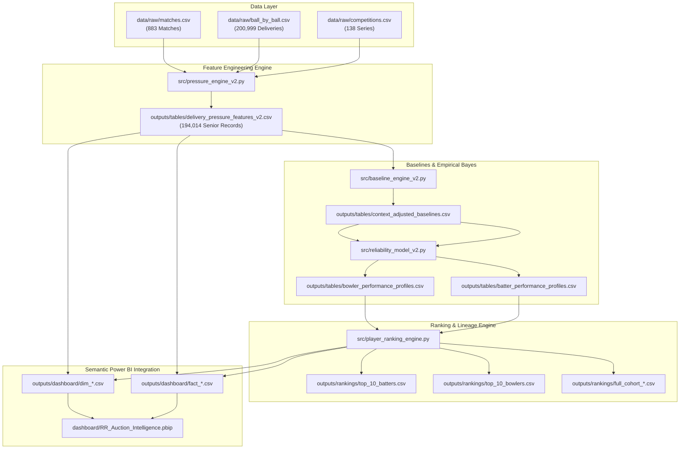

# RR Pressure Index 2027: System Architecture & Data Engineering Topology

---

## 1. System Overview

The **RR Pressure Index 2027** is an end-to-end analytical pipeline designed for deterministic execution, strict zero-leakage pre-delivery state reconstruction, and seamless integration between Python modeling engines and Power BI reporting interfaces.

---

## 2. Core Architectural Principles

1. **Pre-Delivery State Causality:** All pressure indicators ($\Psi_{\text{bat}}, \Lambda_{\text{bowl}}$) are conditioned strictly on variables known prior to the delivery being bowled.
2. **Kish Design Effect Correction:** Intra-cluster correlation is accounted for prior to shrinkage:
   $$deff = 1 + (\bar{m} - 1) \cdot \rho_{\text{ICC}}, \quad N_{\text{eff}} = \frac{N}{deff}$$
3. **Analytic Uncertainty Propagation:** Posterior variances are propagated through to index standard errors.
4. **Decoupled Scoring Interfaces:** Python outputs feed a standard Star-Schema data model in Power BI with zero manual transformation required in Power Query.
