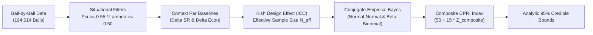

# RR Pressure Index 2027: Evidence-Based Cricket Player Reliability & Auction Intelligence

[](https://www.python.org/downloads/)
[]()
[]()
[]()
[]()

An evidence-based cricket analytics and auction intelligence platform designed for the **Rajasthan Royals (RR) 2027 Mega-Auction**. This system models contextual player performance under match-pressure environments using ball-by-ball IPL and Senior T20 International data.

Rather than relying on unadjusted historical averages, the system constructs two distinct contextual lenses—**Batting Pressure ($\Psi_{\text{bat}}$)** and **Bowling Execution Leverage ($\Lambda_{\text{bowl}}$)**—and applies a **Conjugate Clustered Empirical Bayes Model** with **Intra-Cluster Correlation (ICC)** and **Kish Design Effects** to produce reliable, shrinkage-adjusted player rankings.

---

## 1. Business Objective & Problem Statement

In high-stakes franchise auctions, raw batting strike rates and bowling economy rates create persistent valuation errors:
1. **Context Blindness:** A strike rate of 160 scored in a low-pressure chase with wickets in hand is treated identically to 160 scored in an acute collapse or death-overs clutch.
2. **Small-Sample Distortion:** Emerging domestic talents with small sample sizes ($N < 50$ balls) display erratic, extreme sample means that distort bidding valuations.
3. **Delivery Clustering:** Deliveries bowled within the same match share environmental and match-state dependencies, leading naive models to overestimate certainty.

The **RR Pressure Index 2027** solves these failures by benchmarking performance against dynamic situational pars, adjusting for match-level clustering, and communicating uncertainty via analytic 95% Credible Intervals.

---

## 2. Tournament & Delivery Data Accounting

Following an independent mathematical audit, the match and delivery populations are fully reconciled:

### 2.1 Match Population Accounting
| Population Layer | Matches | Description & Operational Boundary |
| :--- | :---: | :--- |
| **Raw Repository Records** | **883** | Full raw dump across all 138 competition series in `data/raw/matches.csv` |
| *Excluded Emerging Series* | *-30* | Junior "A" tournaments excluded to protect Tier-1 senior integrity |
| **Senior Tournament Cohort** | **853** | Senior Men's T20 matches (IPL + Senior T20Is) across 2021–2026 |
| *Pre-Toss Abandonments* | *-16* | Matches abandoned without a toss or ball bowled |
| **Feature Store Cohort** | **837** | Matches with complete ball-by-ball delivery tracking |
| *Incomplete / Rain Interrupted* | *-24* | Matches ending with "No Result" or mid-match abandonment |
| **Decisive Matches** | **813** | Matches with completed, decisive win/loss outcomes |

### 2.2 Certified Delivery Accounting (837 Feature Store Matches)
- **Total Deliveries Recorded:** `194,014`
- **Batting Legal Deliveries Faced:** `186,540` *(Total - 7,474 Wides)*
- **Bowling Legal Deliveries Bowled:** `185,975` *(Total - 7,474 Wides - 565 No-Balls)*
- **Wides:** `7,474`
- **No-Balls (`Overstep`):** `565`
- **Runs off the Bat:** `261,119`
- **Team Runs (Bat + Extras):** `269,501`
- **Total Dismissals:** `10,486`
- **Bowler-Credited Wickets:** `9,905`

*Note on Historical Discrepancy:* Previous narrative text erroneously cited 187,078 batting legal balls due to a transcription error that listed 5,741 wides instead of 7,474. The audited value across both raw CSVs and processed tables is strictly **186,540**.

---

## 3. Analytical & Statistical Methodology



### 3.1 Contextual Pressure & Leverage
- **Batting Pressure ($\Psi_{\text{bat}} \ge 0.55$):** Multi-factor continuous index combining required run rate strain, wicket scarcity, urgency, and collapse strain.
- **Bowling Execution Leverage ($\Lambda_{\text{bowl}} \ge 0.50$):** Pre-delivery win-probability swing expectation and match closeness.

### 3.2 Clustered Empirical Bayes Shrinkage
To account for within-match delivery correlation ($\rho_{\text{ICC, bowl}} = 0.0159$, $\rho_{\text{ICC, bat}} = 0.0182$), sample size is deflated using Kish's design effect:
$$deff_i = 1 + (\bar{m}_i - 1) \cdot \rho_{\text{ICC}}$$
$$N_{\text{eff}, i} = \frac{N_i}{deff_i}$$

Performance metrics are updated via precision-weighted Gaussian conjugacy:
$$\theta_{\text{Bayes}, i} = \frac{\frac{\mu_0}{\tau_0^2} + \frac{N_{\text{eff}, i} \cdot \bar{y}_i}{\sigma_{\text{within}}^2}}{\frac{1}{\tau_0^2} + \frac{N_{\text{eff}, i}}{\sigma_{\text{within}}^2}}$$

### 3.3 Composite Pressure Reliability Index (CPRI)
Qualified cohorts ($N_{\text{bat}} \ge 50$, $N_{\text{bowl}} \ge 60$) are standardized onto a 0–100 scale:
- **Batting:** $0.40 \cdot Z_{\Delta\text{SR}} + 0.30 \cdot Z_{\text{Bnd\%}} - 0.15 \cdot Z_{\text{Dot\%}} - 0.15 \cdot Z_{\text{Dis\%}}$
- **Bowling:** $-0.40 \cdot Z_{\Delta\text{Econ}} - 0.30 \cdot Z_{\text{Bnd\%}} + 0.15 \cdot Z_{\text{Dot\%}} + 0.15 \cdot Z_{\text{Wkt\%}}$
- **Scaling:** $\text{CPRI} = 50.0 + 15.0 \cdot \text{CPRI}_{\text{raw}}$

---

## 4. Official Audited Player Rankings

### 4.1 Top 10 Batters Under Pressure ($N \ge 50$)
| Rank | Player Name | Matches | Pressure Balls ($N$) | Observed SR | Bayes Posterior SR | CPRI Score | 95% Credible Interval | Confidence Tier |
| :---: | :--- | :---: | :---: | :---: | :---: | :---: | :---: | :---: |
| **1** | **Naman Dhir** | 42 | 91 | 215.38 | 195.15 | **74.41** | [64.48, 84.34] | Tier B ($50 \le N < 100$) |
| **2** | **Tim David** | 98 | 207 | 203.86 | 195.00 | **72.46** | [65.24, 79.68] | Tier A ($N \ge 100$) |
| **3** | **Phil Salt** | 84 | 55 | 232.73 | 199.00 | **71.83** | [60.38, 83.28] | Tier B ($50 \le N < 100$) |
| **4** | **Jos Buttler** | 121 | 146 | 189.04 | 180.34 | **69.30** | [60.98, 77.62] | Tier A ($N \ge 100$) |
| **5** | **Reeza Hendricks** | 34 | 90 | 185.56 | 174.11 | **68.48** | [58.51, 78.45] | Tier B ($50 \le N < 100$) |
| **6** | **Glenn Maxwell** | 75 | 142 | 190.85 | 181.57 | **67.79** | [59.37, 76.21] | Tier A ($N \ge 100$) |
| **7** | **Ashutosh Sharma** | 26 | 140 | 193.57 | 183.60 | **67.47** | [59.01, 75.93] | Tier A ($N \ge 100$) |
| **8** | **Rinku Singh** | 83 | 188 | 186.17 | 179.57 | **67.44** | [59.93, 74.95] | Tier A ($N \ge 100$) |
| **9** | **Suryakumar Yadav** | 139 | 339 | 173.75 | 171.06 | **66.80** | [60.98, 72.62] | Tier A ($N \ge 100$) |
| **10** | **Shreyas Iyer** | 98 | 181 | 183.98 | 177.55 | **66.32** | [58.69, 73.95] | Tier A ($N \ge 100$) |

### 4.2 Top 10 Bowlers Under Leverage ($N \ge 60$)
| Rank | Player Name | Matches | Leverage Balls ($N$) | Observed Econ | Bayes Posterior Econ | CPRI Score | 95% Credible Interval | Confidence Tier |
| :---: | :--- | :---: | :---: | :---: | :---: | :---: | :---: | :---: |
| **1** | **Jasprit Bumrah** | 75 | 763 | 6.94 rpo | 7.1503 rpo | **76.83** | [70.24, 83.42] | Tier A ($N \ge 100$) |
| **2** | **Sikandar Raza** | 52 | 328 | 6.44 rpo | 6.9810 rpo | **75.60** | [66.14, 85.06] | Tier A ($N \ge 100$) |
| **3** | **Haris Rauf** | 48 | 505 | 7.56 rpo | 7.7776 rpo | **74.13** | [66.22, 82.04] | Tier A ($N \ge 100$) |
| **4** | **George Dockrell** | 15 | 76 | 5.29 rpo | 7.2331 rpo | **73.92** | [58.93, 88.91] | Tier B ($60 \le N < 100$) |
| **5** | **Imad Wasim** | 14 | 130 | 5.77 rpo | 7.0760 rpo | **73.50** | [60.36, 86.64] | Tier A ($N \ge 100$) |
| **6** | **Salman Mirza** | 15 | 102 | 6.76 rpo | 7.8228 rpo | **72.00** | [57.90, 86.10] | Tier A ($N \ge 100$) |
| **7** | **Matheesha Pathirana** | 54 | 464 | 7.93 rpo | 8.1083 rpo | **71.76** | [63.56, 79.96] | Tier A ($N \ge 100$) |
| **8** | **Sufiyan Muqeem** | 17 | 114 | 6.26 rpo | 7.4680 rpo | **71.49** | [57.83, 85.15] | Tier A ($N \ge 100$) |
| **9** | **Hasan Mahmud** | 20 | 148 | 7.42 rpo | 8.0313 rpo | **69.96** | [57.34, 82.58] | Tier A ($N \ge 100$) |
| **10** | **Saim Ayub** | 32 | 272 | 6.57 rpo | 7.1695 rpo | **69.85** | [59.67, 80.03] | Tier A ($N \ge 100$) |

---

## 5. Repository Architecture

```text
RR_PRESSURE_INDEX_2027/
├── .gitignore                          # Standard Python / OS ignore rules
├── README.md                           # Authoritative system documentation
├── PROJECT_ARCHITECTURE.md             # System design and pipeline topology
├── METHODOLOGY.md                      # Formal mathematical derivations
├── DATA_DICTIONARY.md                  # Comprehensive column and schema reference
├── REPRODUCIBILITY.md                  # Instructions for deterministic execution
├── MODEL_LIMITATIONS.md                # Statistical boundaries and known constraints
├── dashboard/                          # Power BI PBIP project & interactive reports
│   ├── RR_Auction_Intelligence.pbip    # Power BI Project definition
│   ├── RR_Auction_Intelligence.Dataset # Semantic model definition (model.bim)
│   ├── dax_measures.dax                # Formatted DAX measures
│   └── html/                           # Standalone executive HTML visualizer
├── data/
│   └── raw/                            # Immutable raw source files (883 matches)
├── outputs/
│   ├── tables/                         # 194,014-row feature store & baselines
│   ├── rankings/                       # Top 10 and full cohort ranking tables
│   └── dashboard/                      # Power BI star-schema dimension & fact tables
├── reports/
│   └── audit/                          # Complete Phase 1-5 independent audit reports
│       ├── REPOSITORY_INVENTORY.md
│       ├── DELIVERY_RECONCILIATION.md
│       ├── BAYESIAN_MODEL_INDEPENDENT_AUDIT.md
│       ├── RANKING_LINEAGE_AUDIT.md
│       ├── ROBUSTNESS_AND_LEAKAGE_AUDIT.md
│       └── CLEANUP_PLAN.md
├── src/                                # Core production engineering modules
│   ├── config.py                       # Centralized configuration & logging
│   ├── pressure_engine_v2.py           # Decoupled pressure/leverage formulation
│   ├── baseline_engine_v2.py           # Dynamic par baseline regression
│   ├── reliability_model_v2.py         # Conjugate empirical Bayes engine
│   ├── player_ranking_engine.py        # CPRI composite ranking engine
│   └── run_full_pipeline.py            # Master production pipeline runner
└── tests/                              # Automated Pytest suite (23 unit tests)
    ├── test_data_integrity.py
    ├── test_delivery_accounting.py
    ├── test_feature_engineering.py
    ├── test_bayesian_model.py
    ├── test_rankings.py
    ├── test_leakage.py
    └── test_output_consistency.py
```

---

## 6. Reproduction & Execution Instructions

### Environment Setup
```bash
# Clone the repository
git clone https://github.com/arorautkarsh05-web/RR_Pressure-Index.git
cd RR_Pressure-Index

# Install dependencies
pip install -r requirements.txt  # Or: pip install pandas numpy scipy scikit-learn pytest
```

### Run Full Production Pipeline
```bash
python src/run_full_pipeline.py
```

### Execute Automated Test Suite
```bash
python -m pytest tests/ -v
```

---

## 7. Known Methodological Limitations

1. **Gaussian Rate Approximations:** Normal-Normal conjugacy treats rates as continuous unbounded variables. While mitigated via design effects and $N \ge 50$ thresholds, future iterations should explore Gamma-Poisson GLMMs.
2. **Fixed ICC Assumptions:** Current implementation assumes constant ICC across all bowlers ($\rho = 0.0159$) and batters ($\rho = 0.0182$). Player-specific random match effects represent the next modeling evolution.
3. **Small-Sample Widths:** Players in Tier B ($50 \le N < 100$) display credible intervals spanning 15–20 points, correctly warning franchise strategists against overconfidence.
