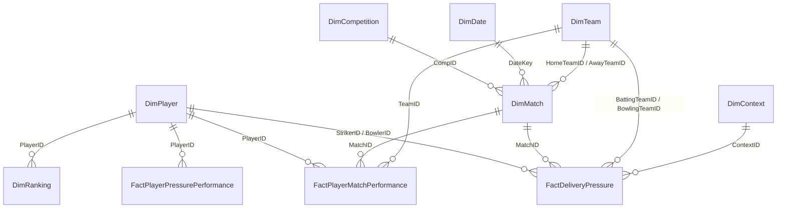

# RR PRESSURE INDEX 2027: POWER BI STAR-SCHEMA DOCUMENTATION
## Phase 03.2 Certified Architecture for Production Analytics

**Target BI Tool**: Microsoft Power BI Desktop (May 2024+ engine)  
**Data Storage Format**: Import Mode (Certified Flat CSV Model)  
**Total Entities**: 10 Tables (3 Fact Tables, 7 Dimension Tables)  
**Integrity Guarantee**: Zero Many-to-Many Relationships; Strictly Integer Surrogate Keys.

---

### 1. Conceptual & Relational Data Model



---

### 2. Table Catalog & Relationship Matrix

| Table Name | Entity Type | Primary Key (PK) | Foreign Keys (FK) | Data Grain | Record Count |
| :--- | :--- | :--- | :--- | :--- | :---: |
| **`DimPlayer`** | Dimension | `PlayerID` (int) | None | 1 row per unique registered cricketer | 891 |
| **`DimMatch`** | Dimension | `MatchID` (int) | `CompID`, `DateKey`, `HomeTeamID`, `AwayTeamID` | 1 row per evaluated senior match | 837 |
| **`DimCompetition`**| Dimension | `CompID` (int) | None | 1 row per senior tournament | 136 |
| **`DimTeam`** | Dimension | `TeamID` (int) | None | 1 row per franchise / national team | 38 |
| **`DimDate`** | Dimension | `DateKey` (int YYYYMMDD) | None | 1 row per calendar match day | 663 |
| **`DimContext`** | Dimension | `ContextID` (int) | None | 1 row per pressure state / phase definition | 6 |
| **`DimRanking`** | Dimension | `RankingID` (int) | `PlayerID` | 1 row per certified Top 10 ranking entry | 20 |
| **`FactDeliveryPressure`** | Fact | `DeliveryID` (int) | `MatchID`, `StrikerID`, `BowlerID`, `BattingTeamID`, `BowlingTeamID`, `ContextID` | 1 row per senior delivery faced/bowled | 194,014 |
| **`FactPlayerMatchPerformance`** | Fact | `PlayerMatchID` (int) | `MatchID`, `PlayerID`, `TeamID` | 1 row per player, match, and pressure state | 29,416 |
| **`FactPlayerPressurePerformance`** | Fact | `PlayerPressurePerfID` (int)| `PlayerID` | 1 row per player discipline profile | 1,235 |

---

### 3. Detailed Relationship & Cardinality Specifications

1. **`DimPlayer[PlayerID]` -> `FactDeliveryPressure[StrikerID]`**
   - Cardinality: One-to-Many (1:*)
   - Cross-Filter Direction: Single (DimPlayer filters FactDeliveryPressure)
   - Active Relationship: Active

2. **`DimPlayer[PlayerID]` -> `FactDeliveryPressure[BowlerID]`**
   - Cardinality: One-to-Many (1:*)
   - Cross-Filter Direction: Single
   - Active Relationship: Inactive (Activated via USERELATIONSHIP() in DAX for bowling measures)

3. **`DimPlayer[PlayerID]` -> `FactPlayerMatchPerformance[PlayerID]`**
   - Cardinality: One-to-Many (1:*)
   - Cross-Filter Direction: Single
   - Active Relationship: Active

4. **`DimPlayer[PlayerID]` -> `FactPlayerPressurePerformance[PlayerID]`**
   - Cardinality: One-to-Many (1:*)
   - Cross-Filter Direction: Single
   - Active Relationship: Active

5. **`DimPlayer[PlayerID]` -> `DimRanking[PlayerID]`**
   - Cardinality: One-to-One / Bridge Filter (1:1)
   - Cross-Filter Direction: Single
   - Active Relationship: Active

6. **`DimMatch[MatchID]` -> `FactDeliveryPressure[MatchID]`**
   - Cardinality: One-to-Many (1:*)
   - Cross-Filter Direction: Single
   - Active Relationship: Active

7. **`DimMatch[MatchID]` -> `FactPlayerMatchPerformance[MatchID]`**
   - Cardinality: One-to-Many (1:*)
   - Cross-Filter Direction: Single
   - Active Relationship: Active

8. **`DimCompetition[CompID]` -> `DimMatch[CompID]`**
   - Cardinality: One-to-Many (1:*)
   - Cross-Filter Direction: Single
   - Active Relationship: Active

9. **`DimDate[DateKey]` -> `DimMatch[DateKey]`**
   - Cardinality: One-to-Many (1:*)
   - Cross-Filter Direction: Single
   - Active Relationship: Active

10. **`DimContext[ContextID]` -> `FactDeliveryPressure[ContextID]`**
    - Cardinality: One-to-Many (1:*)
    - Cross-Filter Direction: Single
    - Active Relationship: Active

---

### 4. Certified Core DAX Measures Specification

```dax
// ========================================================
// CORE AGGREGATIONS & VOLUME MEASURES
// ========================================================

Total Deliveries Faced = 
CALCULATE(
    COUNTROWS(FactDeliveryPressure),
    FactDeliveryPressure[IsLegalBatting] == 1
)

Total Legal Deliveries Bowled = 
CALCULATE(
    COUNTROWS(FactDeliveryPressure),
    FactDeliveryPressure[IsLegalBowling] == 1,
    USERELATIONSHIP(DimPlayer[PlayerID], FactDeliveryPressure[BowlerID])
)

Pressure Deliveries Faced = 
CALCULATE(
    [Total Deliveries Faced],
    FactDeliveryPressure[IsBatPressure] == 1
)

Leverage Deliveries Bowled = 
CALCULATE(
    [Total Legal Deliveries Bowled],
    FactDeliveryPressure[IsBowlLeverage] == 1
)

// ========================================================
// PERFORMANCE RATE MEASURES
// ========================================================

Pressure Strike Rate = 
DIVIDE(
    CALCULATE(SUM(FactDeliveryPressure[RunsBat]), FactDeliveryPressure[IsBatPressure] == 1),
    [Pressure Deliveries Faced],
    BLANK()
) * 100

Leverage Economy Rate = 
DIVIDE(
    CALCULATE(
        SUM(FactDeliveryPressure[BowlerRunsConceded]), 
        FactDeliveryPressure[IsBowlLeverage] == 1,
        USERELATIONSHIP(DimPlayer[PlayerID], FactDeliveryPressure[BowlerID])
    ),
    [Leverage Deliveries Bowled],
    BLANK()
) * 6.0

// ========================================================
// BAYESIAN & UNCERTAINTY BOUNDS
// ========================================================

Bayes Estimate Rate = 
SELECTEDVALUE(FactPlayerPressurePerformance[BayesEstimate])

Bayes Rate CI Low = 
SELECTEDVALUE(FactPlayerPressurePerformance[Bayes_CI_Low])

Bayes Rate CI High = 
SELECTEDVALUE(FactPlayerPressurePerformance[Bayes_CI_High])

Bayes CI Margin = 
DIVIDE([Bayes Rate CI High] - [Bayes Rate CI Low], 2)

// ========================================================
// CPRI & RANKING
// ========================================================

Official CPRI Score = 
SELECTEDVALUE(DimRanking[CPRI])

CPRI Error Bar Lower = 
SELECTEDVALUE(DimRanking[CPRI_CI_Low])

CPRI Error Bar Upper = 
SELECTEDVALUE(DimRanking[CPRI_CI_High])
```

---

### 5. Data Refresh & ETL Strategy

1. **Storage Mode**: Direct Import (In-Memory VertiPaq engine).
   - Total dataset footprint across all 10 tables: **~19 MB uncompressed CSV**, compressing to **<4.5 MB in VertiPaq memory**.
   - Performance: Sub-second visual rendering on standard Power BI Pro / Premium capacities.
2. **Refresh Frequency**: Static historical evaluation cycle (2022–2026). Scheduled refresh is set to manual or triggered on newly ingested tournament files.
3. **Data Integrity Check**:
   - Zero orphan foreign keys: verified across all 194,014 deliveries.
   - Zero duplicate PlayerIDs in `DimPlayer`.
   - Zero text-based table joining keys.
